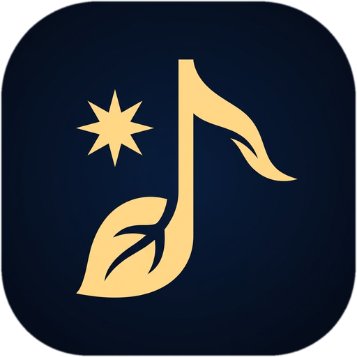
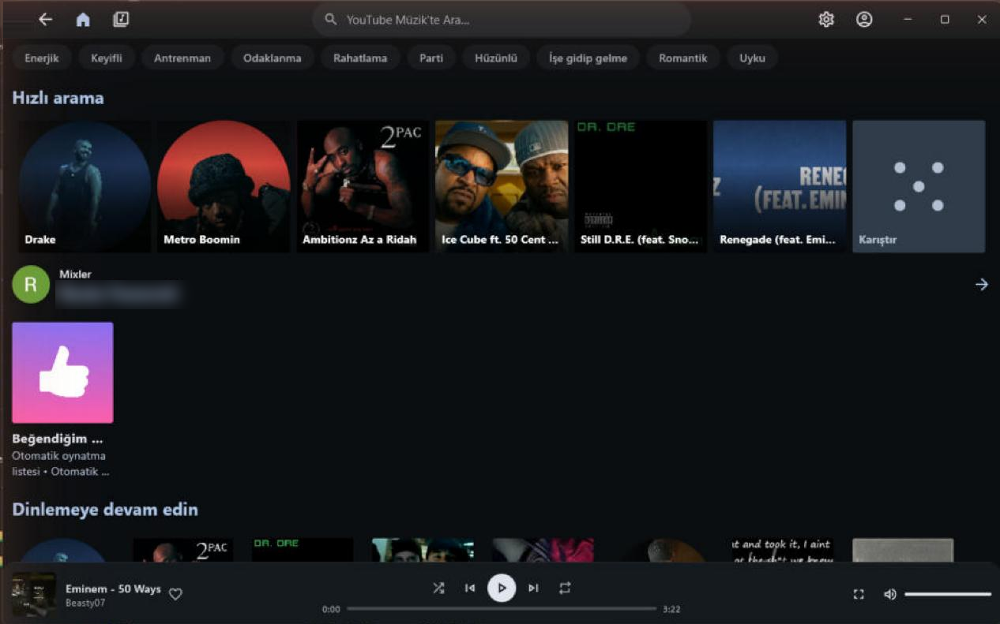
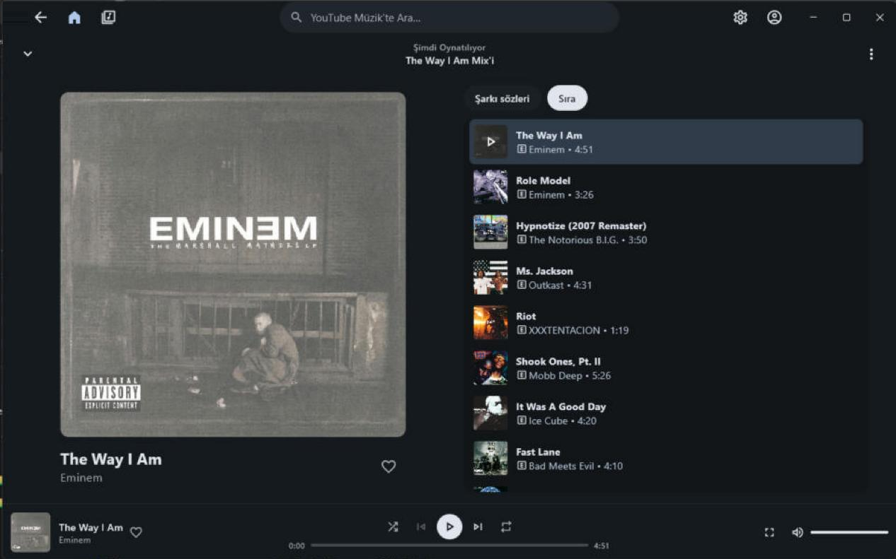
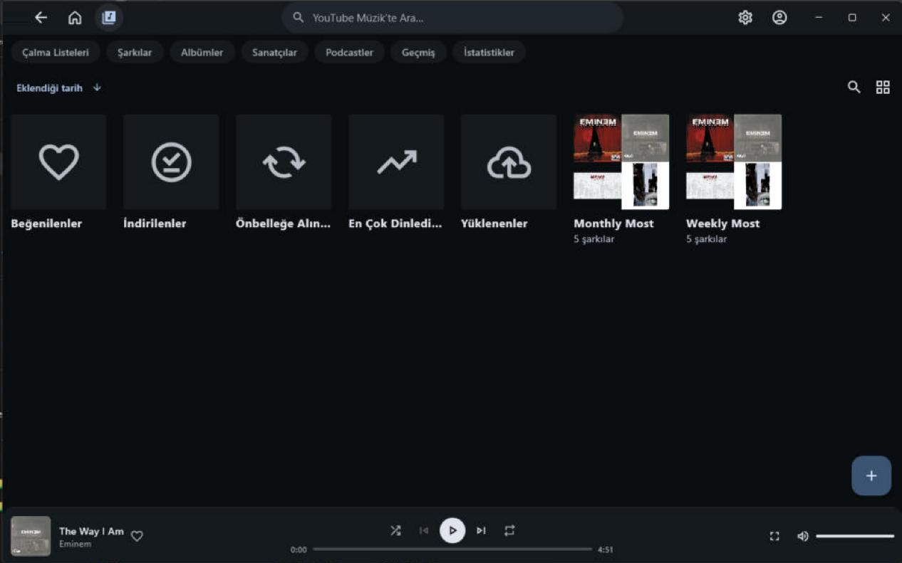

<div align="center">



# Lindalë

**A desktop YouTube Music client for Windows — ad-free, fast, and open source.**

*Lindalë* means "music" in Tolkien's Quenya.

[Download](../../releases/latest) · [Report a bug](../../issues) · [License](LICENSE)

</div>

> **Beta.** Lindale is new. Expect rough edges and please report anything that breaks.

## Screenshots

| Home | Now playing | Library |
|:---:|:---:|:---:|
|  |  |  |

## Features

- **Ad-free YouTube Music** streaming, search, artists, albums, playlists, mixes and radio
- **Your account**: sign in with Google (or a browser cookie) to get your library, likes and history
- **Desktop-first interface**: a single Spotify-style title bar with Home, Library, search and settings
- **Lyrics** from several providers, with a source picker that checks every provider for you, and **tap-to-sync** to fix lyrics that run early or late
- **Offline downloads**, persistent queue (picks up where you left off), and window size/position memory
- **Equalizer**, tempo and pitch control, loudness normalization
- **Discord Rich Presence**
- **Hide clean duplicates**: when a song exists in both explicit and clean versions, show only the explicit one
- **Backups**: restore a backup from Metrolist on Android
- **50+ languages**

## Install

1. Download the latest `Lindale-setup.exe` from [Releases](../../releases/latest).
2. Run it. Windows SmartScreen may say *"Windows protected your PC"* because the installer is not code-signed yet: click **More info → Run anyway**.

Requirements: Windows 10 or 11, 64-bit.

## Build from source

You need Git and a 64-bit **VLC 3.0** install (the app uses libVLC for playback; release builds bundle it).

```bat
git clone https://github.com/supdocquart/Lindale.git
cd Lindale
gradlew.bat :desktop:run
```

Gradle downloads the JetBrains Runtime 21 it needs on the first build. `kur.bat` builds and installs a local copy with Start menu and desktop shortcuts.

## Credits

Lindale is a desktop port of **[Metrolist](https://github.com/MetrolistGroup/Metrolist)** by MO Agamy and contributors, which itself builds on InnerTune and OuterTune. All the hard work on the YouTube Music side is theirs; thank you.

Lindale also uses [libVLC](https://www.videolan.org/vlc/libvlc.html) (LGPL-2.1), [JetBrains Runtime](https://github.com/JetBrains/JetBrainsRuntime) with JCEF, [Compose Multiplatform](https://www.jetbrains.com/compose-multiplatform/), Room, Ktor, Coil and Koin.

## License

Lindale is free software under the [GNU General Public License v3.0](LICENSE), like Metrolist it is based on.

## Disclaimer

Lindale is not affiliated with, endorsed by, or connected to YouTube, Google or Metrolist. YouTube and YouTube Music are trademarks of Google LLC.
